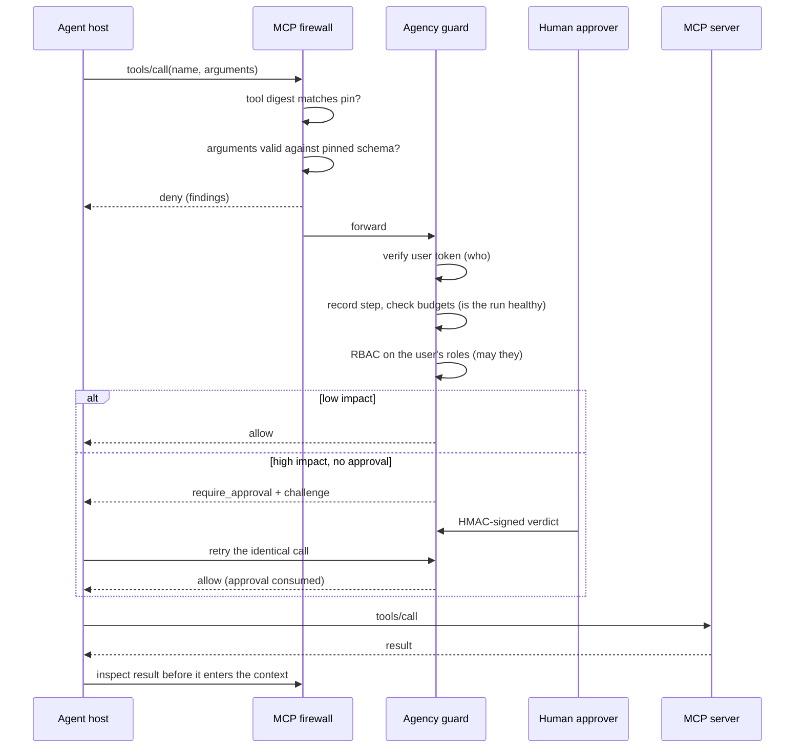

# Architecture

aegis-mcp is a policy enforcement point. It sits on the path between an agent host and
every resource the agent can reach, and each request passes a fixed pipeline of
deterministic checks.

## Request lifecycle of a tool call

The order in the agency guard is deliberate. Identity comes first so that every later
decision and audit record has a subject. The budget is charged before the policy check
so that denied calls still count: an agent hammering a forbidden tool is itself a loop.

## Modules

### `core`

`Finding` (rule ID, severity, evidence, framework references), `Decision`, canonical
JSON hashing and the audit logger. Every digest in the project uses
`core.canonical.sha256_hex`, so two components can never disagree about what was hashed.
Text is deliberately not Unicode-normalised before hashing: adding one zero-width
character to a tool description must change its digest.

### `mcp_firewall`

- `unicode_smuggling` counts zero-width, bidirectional-control, variation-selector and
  Unicode Tag characters, and decodes Tag payloads back to ASCII.
- `rules` holds the pattern rules as data.
- `scanner` walks the tool description, every text-bearing JSON Schema keyword at any
  depth (`description`, `default`, `enum`, `const`, `examples`, `title`), parameter names,
  and any extra fields. Each string is scanned three ways: as written, with invisible
  characters stripped, and as the decoded hidden payload. Splitting a trigger phrase with
  zero-width characters therefore does not evade the rules.
- `pinning` stores `sha256` of the canonical tool definition per server. The lock file
  carries an HMAC, so editing it on disk is detected.
- `firewall` combines them. A tool is passed to the model only if it scans clean **and**
  matches its pin. Call arguments are validated with a JSON Schema validator, and the
  schema is treated as closed: arguments the schema did not declare are rejected even if
  the schema omitted `additionalProperties: false`.

### `agency_guard`

- `identity` verifies an HS256 JWT with a pinned algorithm list and required `exp`,
  `iat`, `sub`, `aud`, `iss` claims. The tenant claim is mandatory.
- `policy` is default-deny RBAC over tool-name globs. Deny beats allow. Tools carry an
  impact level; unknown tools default to high.
- `hitl` issues approval challenges. The signed payload covers the challenge ID, the
  call digest (tool name plus canonical arguments), the expiry, the approver and the
  verdict. Challenges are single-use and are burned on the first submission, valid or
  not. The requester cannot approve their own call.
- `circuit_breaker` enforces per-run ceilings on steps, recursion depth, tokens and cost,
  and detects loops by hashing (tool, arguments, observation). A tripped breaker stays
  open for that run.

### `io_sanitization`

- `detectors` and `dlp` redact secrets, PII and configured canary strings. Card and
  Canadian SIN matches are Luhn-validated to keep false positives low. Reasoning blocks
  (`<thinking>` and similar) are dropped by default; an unclosed tag swallows the rest of
  the output.
- `sinks` validates output bound for execution:
  - shell: no metacharacters, one allowlisted binary by bare name, per-binary forbidden
    flags; returns an argv for `shell=False`.
  - SQL: parsed with sqlglot; one statement, allowlisted statement type, tables and
    functions, and no inline literals in predicates (values must be bind parameters).
  - Markdown: images whose host is not allowlisted over HTTPS are removed, including
    HTML `` and reference-style images.
  - packages: names in install commands must be on the organisation's allowlist;
    near-misses are reported as probable typosquats.

### `rag_guard`

- `store` keeps one partition per tenant. The only way to address a partition is with a
  verified `UserIdentity`; no method accepts a tenant ID as a parameter.
- `guard` checks ingestion (writer role, trusted source host, content scan) and
  retrieval (tenant re-assertion, integrity digest, content re-scan, relevance floor),
  then wraps the surviving text in per-call random delimiters marked as data.

### `redteam` and `api`

The red-team runner builds a fresh set of services with random keys for every case and
drives the real code paths. The lab UI and the pytest suite both consume the same corpus,
so there is one definition of "what must be blocked".

The API is a thin layer over the same service objects. Request models forbid unknown
fields. Responses carry a strict Content-Security-Policy with no inline script or style;
the lab front end writes all attacker-controlled text with `textContent`.

An instance runs in one of three modes, chosen once at start-up (`api/modes.py`):
production mounts only the guard API; lab adds the landing page, the attack lab and the
interactive docs for local use; public demo mounts the landing page and lab **without**
the guard API or docs, and rate limits case runs. Routes a mode does not need are not
mounted at all, so they answer 404 instead of relying on an authentication check.

## Extending

Each stateful component has a narrow interface (`Embedder`, `TenantVectorStore`,
`ApprovalGate`, `CircuitBreaker`). Moving to Redis, Postgres with row-level security, or
a managed vector database means reimplementing those classes; the guards and the corpus
do not change, and the corpus tells you whether the new backend preserved the guarantees.
